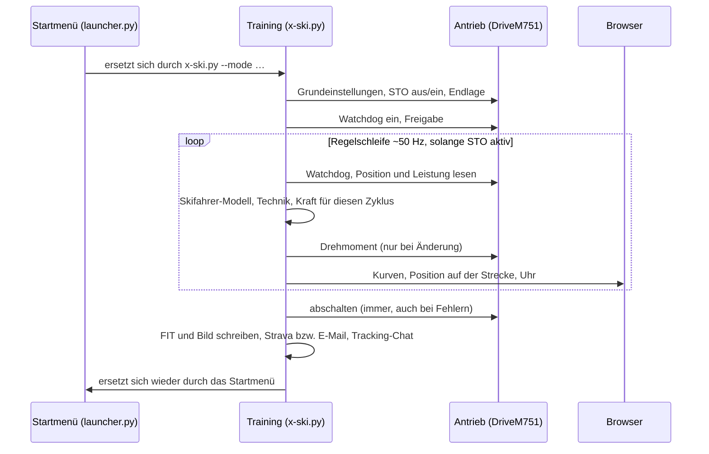

# x-ski – Double-Poling-Ergometer

x-ski ist ein Langlauf-Ergometer für Double Poling: Ein Servoantrieb (Nidec Digitax HD M751) bremst zwei
Seilzüge, ein Raspberry Pi 5 regelt die Kraft und zeigt das Training im Browser an. Diese Dokumentation
beschreibt Installation, Bedienung, Einstellungen und den Aufbau der Software.

- [Installation](#installation)
- [Starten und Bedienen](#starten-und-bedienen)
- [Trainingsarten](#trainingsarten)
- [Profil und Einstellungen](#profil-und-einstellungen)
- [Streckensimulation](#streckensimulation)
- [Auswertung](#auswertung)
- [Strava, E-Mail, Live-Tracking und Meldungen](#strava-e-mail-live-tracking-und-meldungen)
- [Seilzug kalibrieren](#seilzug-kalibrieren)
- [Sicherheit](#sicherheit)
- [Dateien und Ordner](#dateien-und-ordner)
- [Tests und Werkzeuge](#tests-und-werkzeuge)
- [Aufbau der Software](#aufbau-der-software)

## Installation

Voraussetzung ist ein Raspberry Pi 5 mit Raspberry Pi OS (getestet mit Kernel 6.6 und 6.12) und ein Browser
(Chromium). Der Antrieb ist über Modbus TCP erreichbar (Adresse im Profil, Abschnitt `drive`).

```
git clone https://github.com/gianlucapargaetzi/xc-skiing-hometrainer.git
cd xc-skiing-hometrainer/scripts
./install_environment.sh          # legt die virtuelle Umgebung .venv an
cd ..
cp .env.example .env && chmod 600 .env   # Zugangsdaten eintragen, siehe unten
```

### Zugangsdaten (`.env`)

Die Datei `.env` im Projektordner wird nie ins Git übernommen. Alle Einträge sind optional; ohne sie ist die
jeweilige Funktion einfach aus.

| Eintrag | Wofür |
|---|---|
| `SMTP_SERVER`, `SMTP_PORT`, `SMTP_USER`, `SMTP_PASS`, `SMTP_FROM` | E-Mail mit der Trainingsdatei |
| `STRAVA_CLIENT_ID`, `STRAVA_CLIENT_SECRET` | Strava-App dieser Installation (für alle Profile gleich) |
| `TRACKING_DEVICE_ID`, `TRACKING_SK` | Meldungen an den Tracking-Chat (gps-live) |
| `X_SKI_ALLOW_REMOTE_CONFIG=1` | Einstellungen auch von anderen Geräten im Netz ändern |

## Starten und Bedienen

```
src/x-ski.sh
```

Das Skript startet das **Startmenü** im Browser (`http://localhost:5000/`) und schreibt die Konsolenausgabe
nach `logs/`. Das Startmenü berührt den Antrieb nicht. Nach der Wahl eines Trainings ersetzt es sich durch
das Trainingsprogramm (`x-ski.py`); nach dem Training erscheint wieder das Startmenü.

Im Startmenü:

- **Profil**: Kachel antippen lädt das Profil, «Bearbeiten» öffnet das Formular, «Neu» legt eines an.
- **Training**: Belastungsprofil, Intervall, Auswertung.
- **Strecken**: eine Kachel pro GPX-Datei in `src/routes/`. Antippen öffnet die Abschnittswahl (Start und
  Ziel auf der Karte oder im Höhenprofil setzen, «Weiterlaufen ab km …», «Ganze Strecke»).
- **Beenden** oben rechts schliesst x-ski. Ohne Lebenszeichen vom Browser beendet sich x-ski nach 90 s selbst
  (ein laufendes Training wird dabei wie mit Stop beendet und ab 5 min gespeichert).

Jedes Training beginnt gleich: Seil 50 cm herausziehen, Sicherheitsschalter auslösen und wieder einschalten,
Griffe langsam zum oberen Anschlag führen. Die Uhr startet mit dem ersten Zug.

Während des Trainings:

- **Pause** schaltet den Antrieb aus und hält Uhr, Strecke und Aufzeichnung an. «Weiter» zählt 3 s herunter,
  dann wird der Antrieb freigegeben und spannt das Seil.
- **Stop** fragt nach. Bei weniger als 5 min Trainingszeit kannst du speichern oder verwerfen. Danach wird
  der Antrieb abgeschaltet und es geht zurück ins Startmenü (nach einem Streckentraining zuerst zur
  Auswertung).

Direkt von der Kommandozeile (für Tests):

```
cd src/webgui && source ../../.venv/bin/activate
python3 x-ski.py --mode skier --route "Sertig Classic 13k.gpx" [--route-start-km 4.2] [--route-end-km 9.0]
python3 x-ski.py --mode profile | --mode interval | --mode calib
# optional: --no-browser, --host 127.0.0.1, --config <datei>
```

## Trainingsarten

| Kachel | Modus | Widerstand am Seil | Tempo und Distanz |
|---|---|---|---|
| Strecke | `skier` | aus Gelände und Tempo des virtuellen Skifahrers, einmal pro Stoss festgelegt | aus deiner Leistung am Seil und der Steigung der Strecke |
| Belastungsprofil | `profile` | Kraftkurve × Intensität (Tasten + / −) | aus deiner Leistung am Seil, ohne Strecke |
| Intervall | `interval` | Kraftkurve × Intensität aus der Programmdatei (`src/intervals/*.xciv`) | wie Belastungsprofil; Steigung optional aus der Datei |

Die Kraft am Seil hängt von der Position ab (Kraftkurve über den Zug). Beim Ziehen wirken Grundzug und
Stosskraft, beim Zurückholen nur die Rückzugskraft. Im letzten Drittel des Zugs gilt eine Mindestkraft
(«Gegenkraft am Zugende»), damit das Seil beim Abbremsen der Hände gespannt bleibt.

## Profil und Einstellungen

Ein Profil ist eine JSON-Datei in `src/webgui/configs/`; das aktive Profil liegt zusätzlich als
`src/webgui/x-ski.json` vor. Beide sind persönlich und nicht im Git, ausser der Vorlage
`configs/x-ski.default.json`, aus der neue Profile entstehen. Die wichtigsten Werte stellst du im Formular
(Startmenü → Profil → Bearbeiten) ein; Änderungen wirken sofort, auch während eines Trainings.

| Wert im Formular | Schlüssel | Standard | Bedeutung |
|---|---|---|---|
| Grundzug beim Stoss | `control.min_torque_pct` | 5 % | Kraft, gegen die du immer ziehst |
| Rückzugskraft | `control.recovery_torque_pct` | 30 % | holt das Seil zurück und hält es gespannt |
| Gegenkraft am Zugende | `control.end_pull_torque_pct` | 15 % | Mindestkraft im letzten Drittel des Zugs |
| Rückzugs-Geschwindigkeit | `control.pull_speed` | 3000 rpm | höchste Drehzahl beim Aufwickeln (≈ 8 m/s) |
| Startwert Belastungsprofil | `control.simple_initial_power_pct` | 70 | Intensität beim Start |
| Gleitreibung Ski | `user.mu` | 0.025 | bestimmt das Tempo auf Schnee |
| Wechsel auf Diagonal ab | `user.diagonal_from_slope_percent` | 3.5 % | Technik «Auto» |
| Ausrüstung | `simulation.equipment_kg` | 3 kg | kommt zum Körpergewicht dazu |

100 % Drehmoment entsprechen dem Motor-Nennmoment (`simulation.motor_rated_torque_nm`, 2.88 Nm) und damit
etwa 109 N am Seil (Trommelradius 26.5 mm).

Nur in der Datei bzw. über die Konfigurationsseite einstellbar (Abschnitt `simulation`):

| Schlüssel | Standard | Bedeutung |
|---|---|---|
| `power_scale` | 2.6 | Leistung am Seil → Vortrieb auf Schnee |
| `diagonal_power_factor` | 0.9 | Faktor auf den Vortrieb im Diagonalschritt |
| `diagonal_arm_share` | 0.4 | Anteil der Kraft, den die Arme im Diagonalschritt tragen |
| `feel_mu` | 0.02 | Gleitreibung für das Kraftgefühl am Seil (getrennt vom Tempo) |
| `downhill_feel_floor` | 0.5 | Stosswiderstand bergab, als Anteil der Gleitreibung in der Ebene |
| `cda_m2`, `air_density_kg_m3` | 0.45, 1.0 | Luftwiderstand |
| `max_rope_force_n`, `max_force_step_n` | 180, 30 | Obergrenze der Stosskraft und Änderung pro Stoss |
| `route_slope_factor` | 1.0 | dämpft oder verstärkt die Steigung der Strecke |

### Antrieb der Maschine (ein oder zwei Motoren)

Welcher Antrieb eingebaut ist, steht nicht im Profil, sondern gilt für die ganze Maschine
(`src/webgui/maschine.json`, wird nicht versioniert). Umgestellt wird im Profil-Formular unter **Maschine**;
die Änderung wirkt beim nächsten Trainingsstart.

| Einstellung | Antrieb | Verbindung |
|---|---|---|
| Nidec Digitax HD M751 (Standard) | ein Motor, beide Seile auf einer Trommel | Modbus TCP |
| Delta ASDA-B3A-E, 1 oder 2 Motoren | ASD-B3A-0421-E mit ECM-B3M-C20604 (400 W) | EtherCAT (`pysoem`) |

Die Regelschleife kennt nur eine gemeinsame Schnittstelle (`HardwareController/factory.py`): Drehmoment in
Prozent des Bezugsdrehmoments (`simulation.motor_rated_torque_nm`, Summe über alle Seile), Position in
65536 Schritten pro Umdrehung, Drehzahl in rpm. Grundzug, Rückzug und Stosskraft bedeuten deshalb mit
beiden Antrieben dasselbe. Mit zwei Motoren bekommt jeder die halbe Kraft; die Regelung sieht den Mittelwert
beider Seile. Eine getrennte Regelung pro Arm (Diagonalschritt) ist noch nicht gebaut.

**Der Delta-Treiber (`DriveDeltaB3.py`) ist nach dem Handbuch geschrieben und nur mit einem simulierten Bus
getestet – an der Hardware noch nicht.** Vor dem ersten Betrieb zu klären:

- Python braucht das Recht für EtherCAT:
  `sudo setcap cap_net_raw,cap_net_admin+ep $(readlink -f .venv/bin/python)`
- Der Netzwerkanschluss (`interface`, Standard `eth0`) gehört dann dem EtherCAT; der M751 hängt heute am selben Anschluss.
- Weitere Werte in `maschine.json` unter `drive` (Standardwerte in `Utils/machine.py`): `counts_per_rev`,
  `motor_max_torque_pct`, `cycle_ms`, `dc_sync`.
- Die Drehzahlgrenze beim Rückzug macht die Software (Drehmoment wird über der Grenze zurückgenommen).
- Ohne angeschlossenen Sicherheitsschalter («STO angeschlossen» aus) nur auf dem Tisch ohne Seil testen.

## Streckensimulation

Ein virtueller Skifahrer (`Utils/skier_model.py`) läuft die GPX-Strecke ab:

```
m · dv/dt = F_vortrieb − µ·m·g·cosθ − m·g·sinθ − ½·ρ·CdA·v²
```

- **Strecke**: Aus dem GPX werden nur Position und Höhe gelesen. Die Höhe wird über 60 m geglättet, die
  Steigung über 100 m gemittelt und auf ±25 % begrenzt. Zeitstempel und Sportart der GPX-Datei spielen für
  die Simulation keine Rolle; alle Modellwerte stehen im Profil und gelten für jede Strecke.
- **Tempo**: Die gemessene Leistung am Seil wird mit `power_scale` (im Diagonalschritt zusätzlich mit
  `diagonal_power_factor`) als Vortrieb eingerechnet.
- **Kraft am Seil**: Aus dem Fahrwiderstand an der aktuellen Stelle wird pro Stoss eine Spitzenkraft
  bestimmt (`StrokeForcePlanner`), höchstens `max_force_step_n` anders als beim vorherigen Stoss. Bergab
  bleibt ein Mindestwiderstand, damit man gegen die Stöcke stossen und beschleunigen kann.
- **Technik**: «Auto» geht zwischen etwa 2 % und 4 % Steigung fliessend von Double Poling auf Diagonal über
  (über 3 Stösse); im Diagonalschritt werden die Arme entlastet. Die Leiste oben in der Karte zeigt die
  aktuelle Technik, die Tasten unten legen sie fest (Auto / Double Poling / Diagonal).
- **Tasten + / −** verschieben die Steigung zusätzlich (100 % = Strecke wie sie ist).
- **Anzeige**: Karte (in der Schweiz swisstopo-Winterkarte, sonst OpenTopoMap), Infobox oben links,
  Nahprofil −500 m bis +1000 m oben rechts, ganzes Höhenprofil unten.
- **Über das Ziel hinaus** bleibt die Position am Endpunkt stehen (Steigung 0); das Training läuft weiter,
  bis du Stop drückst.
- **Verpflegungsposten**: Liegt neben dem GPX eine Datei `<Strecke>.posten.json`, erscheinen die Posten auf
  der Karte, in allen Höhenprofilen, in der Auswertung und im Zusammenfassungsbild; die Infobox zeigt den
  nächsten Posten mit Distanz. `km` ist die Distanz auf der GPX-Strecke (bei Hin- und Rückweg kommt derselbe
  Ort zweimal vor), `info`, `offiziell_km` und `verpflegung: false` (z. B. Wendepunkt) sind optional:
  ```json
  {"posten": [{"name": "Brändön", "km": 14.53, "offiziell_km": 15},
              {"name": "Granudden", "km": 70.72, "info": "warme Mahlzeit"}]}
  ```

Die Modellwerte sind am 7. und 11.10.2026 mit zwei Läufen auf der Sertig Classic 13k gegen den echten
GPS-Lauf abgestimmt worden (siehe `tools/compare_gpx.py`).

## Auswertung

Kachel «Auswertung» im Startmenü, und automatisch nach dem Stop eines gespeicherten Streckentrainings.

- Liste aller FIT-Dateien im Ordner `trainings/`; «FIT-Datei laden …» kopiert eine Datei von aussen dorthin.
- Die Strecke einer Aufzeichnung wird aus ihren GPS-Punkten erkannt (nicht aus dem Dateinamen), ebenso der
  Startpunkt bei einem Abschnitt.
- Gezeigt werden: Tempo über die Strecke (blau = Original aus dem GPX, rot = Training), Höhenprofil, Tempo
  nach Gelände, Höhenmeter, Puls, Leistung, Kadenz, Arbeit, Meter pro Stoss, Effizienz (Watt pro
  Pulsschlag), Entkopplung und die Zeit pro Zone (Puls, Kadenz, Leistung, Pace).
- Die Originalkurve gibt es nur, wenn das GPX Zeitstempel hat (ein echter, aufgezeichneter Lauf).

«Weiterlaufen» in der Abschnittswahl nutzt dieselbe Erkennung: Pro Strecke zählt das zuletzt gestartete
Training; sein Endpunkt wird als Startpunkt angeboten, solange bis zum Ziel mehr als 300 m bleiben.

## Strava, E-Mail, Live-Tracking und Meldungen

Nach einem gespeicherten Training entsteht in `trainings/` eine FIT-Datei (Sekundenwerte mit Puls, Kadenz,
Leistung; in der Streckensimulation zusätzlich GPS, Höhe und Steigung) und ein Bild der Zusammenfassung
(PNG mit gleichem Namen).

| Funktion | Einrichtung | Verhalten |
|---|---|---|
| **Strava** | `.env`: Client ID und Secret. Im Profil «Mit Strava verbinden» (pro Profil ein eigenes Konto) und «automatisch hochladen» | Upload als Skilanglauf, ohne Indoor-Markierung (damit Karte und Höhenmeter erscheinen) |
| **E-Mail** | `.env`: SMTP. Adresse im Profil | geht nur raus, wenn der Strava-Upload aus ist oder scheitert; FIT und Bild hängen an |
| **Traccar** | Abschnitt `traccar` im Profil (`osmand` per HTTP oder `eelink` per TCP) | sendet in der Streckensimulation die virtuelle Position alle `interval_s` Sekunden |
| **Tracking-Chat** | `.env`: `TRACKING_DEVICE_ID`, `TRACKING_SK`. Im Profil unter «Live-Tracking» einschalten | Streckensimulation: beim ersten Zug «Training gestartet. Folge mir unter: …», am Ende das Bild der Zusammenfassung mit «Training beendet.», Kurzfassung und Strava-Link |

Die Chat-Meldungen laufen im Hintergrund und halten das Training nie auf. Scheitert der Bildversand, folgt
die Schlussmeldung als reiner Text. Bei Abbruch oder verworfenem Training kommt nur «Training beendet.».
Fotos lassen sich über die Strava-Schnittstelle nicht hochladen; das Bild kann von Hand angehängt werden.

## Seilzug kalibrieren

Profil → Bearbeiten → «Seilzug kalibrieren» startet einen geführten Test (etwa 10 Minuten):

1. Freilauf bei drei Kräften (Griff ausziehen, ganz loslassen) → bewegte Masse und Reibung.
2. Stösse leicht, mittel, hart und ein Sprint im Flachen → wie schnell die Hände zurückkommen.
3. Rückzugsstufen und Grundzugstufen mit Bewertung (1–5 Sterne).
4. Prüfung mit den vorgeschlagenen Werten.

Am Schluss steht ein Vorschlag für Grundzug, Rückzugskraft und Drehzahlgrenze; übernommen wird er erst mit
«Ins Profil übernehmen». Alle Messwerte landen als `logs/seilzug_<datum>.json`. Unplausible
Freilauf-Messungen (z. B. gebremster Griff) werden verworfen und der Schritt muss wiederholt werden.

## Sicherheit

- Der Antrieb läuft nur mit eingeschaltetem Sicherheitsschalter (STO). Wird er ausgelöst, endet das Training.
- Ein Watchdog im Antrieb schaltet ab, wenn das Programm länger als 1 s nichts sendet.
- Beim Beenden, bei Fehlern und in der Pause wird der Antrieb immer abgeschaltet.
- Oberhalb des Software-Nullpunkts (50 mm unter dem oberen Anschlag) ist der Antrieb frei.
- Grenzen: Die Kalibrierung testet und schlägt höchstens 40 % für Grundzug und Rückzug und 3000 rpm vor.
  Von Hand lassen sich im Profil bis 60 % eintragen.
- Motor und Bremswiderstand werden überwacht (Warnung ab 75 % Auslastung, alle 30 s im Log).
- **Steuern nur am Gerät**: Nur der Browser direkt am x-ski (localhost) kann steuern. Jede ändernde Anfrage
  von einem anderen Gerät wird vom Server abgelehnt (`Utils/access.py`), ausser mit
  `X_SKI_ALLOW_REMOTE_CONFIG=1`.
- **Zuschauer**: Ein zweiter Browser im Netz (`http://<adresse-des-pi>:5000/`) sieht ohne Training nur
  «Warten auf Training». Während eines Trainings zeigt er automatisch dieselbe Seite wie der Browser am
  Gerät, mit gesperrten Bedienelementen und dem Hinweis «Nur Ansicht». Zuschauer halten x-ski nicht am
  Leben: schliesst der Browser am Gerät, beendet sich x-ski wie gewohnt.

## Dateien und Ordner

| Ort | Inhalt | im Git |
|---|---|---|
| `src/routes/*.gpx` | Strecken | nein |
| `src/routes/*.posten.json` | Verpflegungsposten zu einer Strecke | ja |
| `src/intervals/*.xciv` | Intervallprogramme (YAML) | ja |
| `src/webgui/configs/`, `src/webgui/x-ski.json` | Profile, aktives Profil | nur die Vorlage |
| `trainings/` | `<Strecke>_<Datum>_<Zeit>.fit` bzw. `skiErg_<Datum>_<Zeit>.fit`, dazu `.png`; `letzter_vergleich.json` | nein |
| `logs/` | Konsolenausgabe pro Start, Messwerte der Kalibrierung | nein |
| `strava_tokens/` | Strava-Zugang pro Konto | nein |
| `.env` | Zugangsdaten | nein |

Intervalldateien können die Steigung vorgeben (gilt für Tempo und Distanz):

```yaml
anstieg:
  type: duration_block
  duration: 300
  intensity_start: 100
  intensity_end: 100
  slope_start: 0      # Steigung in %, optional
  slope_end: 8
hügel:
  type: interval_block
  on_duration: 60
  off_duration: 60
  block_amount: 4
  on_intensity: 160
  off_intensity: 70
  on_slope: 6         # optional
  off_slope: -2       # optional
```

## Tests und Werkzeuge

```
cd src/webgui && ../../.venv/bin/python -m pytest tests
```

Werkzeuge in `tools/` (jeweils mit `.venv/bin/python` aus dem Projektordner starten):

| Werkzeug | Zweck |
|---|---|
| `sim_xski.py <ordner> [sekunden] -- --mode …` | x-ski mit simuliertem Antrieb und simuliertem Nutzer auf Port 5097; keine E-Mail, kein Strava, kein Traccar, Chat nur mit `SIM_CHAT=1` |
| `screenshot.py <url> <bild.png> <breite,höhe> [schritte]` | Seite in Chromium laden, optional JavaScript ausführen, Bild speichern |
| `add_elevation.py <gpx>` | Höhen in ein GPX ohne Höhenangaben eintragen (Schweiz, Geländemodell von swisstopo); ohne Höhe ist eine Strecke «nicht lesbar» |
| `compare_gpx.py <fit> <gpx> [--png bild.png]` | Aufzeichnung abschnittsweise mit dem echten Lauf vergleichen |
| `replay_fit.py <fit> <gpx> --power-scale … [--target-min …] [--out …]` | Aufzeichnung mit anderen Modellwerten neu auf die Strecke rechnen |

Port 5000 gehört dem echten x-ski. Testserver laufen auf 5097 (Simulation) und 5099
(`launcher.py --port 5099 --no-browser`); mit `X_SKI_TRAININGS_DIR` nutzt das Startmenü einen eigenen
Trainingsordner.

## Aufbau der Software

```
src/
├── x-ski.sh                        Start: Startmenü, Log nach logs/
├── x-ski_iic.sh                    direkt im Intervall-Modus (ohne Startmenü)
├── intervals/, routes/             Intervallprogramme, Strecken
├── legacy/                         alter, nicht mehr verwendeter Code (nur Referenz)
└── webgui/
    ├── launcher.py                 Startmenü: Profile, Strecken, Auswertung; startet x-ski.py
    ├── x-ski.py                    Training: Web-Routen, Regelschleife, Speichern, Kalibrierung
    ├── BasicWebGUI.py              Flask/SocketIO-Backend
    ├── HardwareController/DriveM751.py   Modbus-TCP zum Antrieb (Register, Watchdog, Abschalten)
    ├── IntensityController/        Intensität: Tasten (Simple) oder Programmdatei (Intervall)
    ├── ValueHandler/Scope.py       Kurven und Kennzahlen ans Dashboard
    ├── Utils/
    │   ├── settings.py, config_manager.py, profile_page.py   Einstellungen, Profile, Profil-Formular
    │   ├── skier_model.py          virtueller Skifahrer, Kraftplaner pro Stoss
    │   ├── force_profile.py, stroke_analysis.py, zones.py    Kraftkurve, Auswertung pro Stoss, Zonen
    │   ├── route.py                GPX-Strecke: Distanz, Höhe, Steigung, Abschnitt, Nahprofil
    │   ├── fit_export.py           FIT-Datei schreiben
    │   ├── speed_compare.py        Auswertung: Vergleich mit dem Original, Kennzahlen, Zonen, Streckenerkennung
    │   ├── summary_image.py        Zusammenfassung als Bild
    │   ├── strava_client.py        Strava: Anmeldung pro Konto, Upload
    │   ├── chat_notify.py          Meldungen an den Tracking-Chat
    │   ├── traccar_osmand.py, traccar_eelink.py              Live-Position an Traccar
    │   ├── rope_calibration.py     Ablauf und Auswertung der Seilzug-Kalibrierung
    │   ├── email_utils.py, credentials.py                    E-Mail, Zugangsdaten aus .env
    │   └── ble_manager.py, ant_hr_manager.py                 BLE-FTMS-Ausgang, ANT+ Puls
    ├── templates/                  start, profil, auswertung, vergleich, route, dashboard, simple, interval, calibration
    ├── static/js/session_end.js    Stop, Pause und Rückkehr ins Startmenü für alle Trainingsseiten
    └── tests/                      pytest
tools/                              Simulation, Screenshot, Vergleich, Neuberechnung
```

### Ablauf eines Trainings



Die Regelschleife gibt alle 30 s ihre Frequenz, die längste Zykluszeit und die Auslastung von Motor und
Bremswiderstand auf der Konsole aus.
